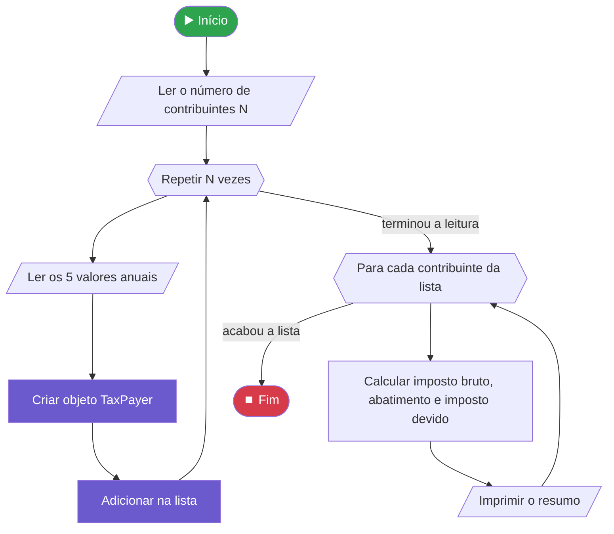
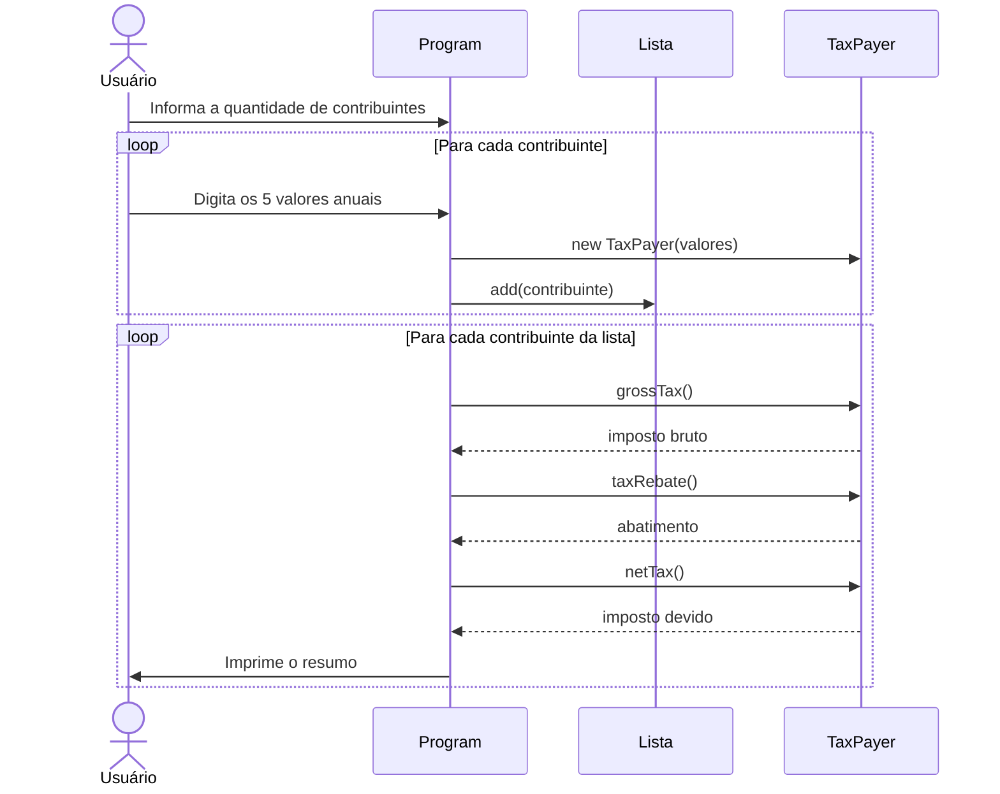
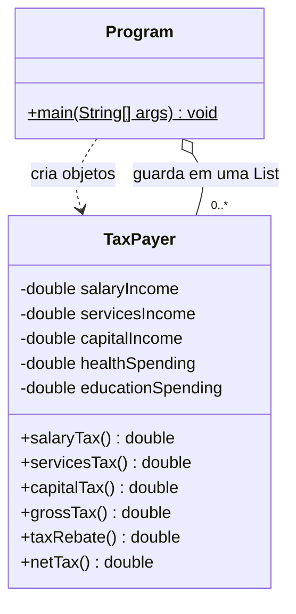
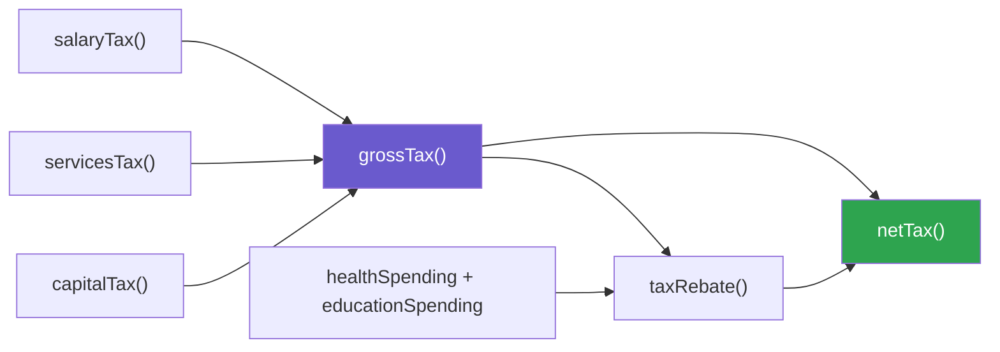
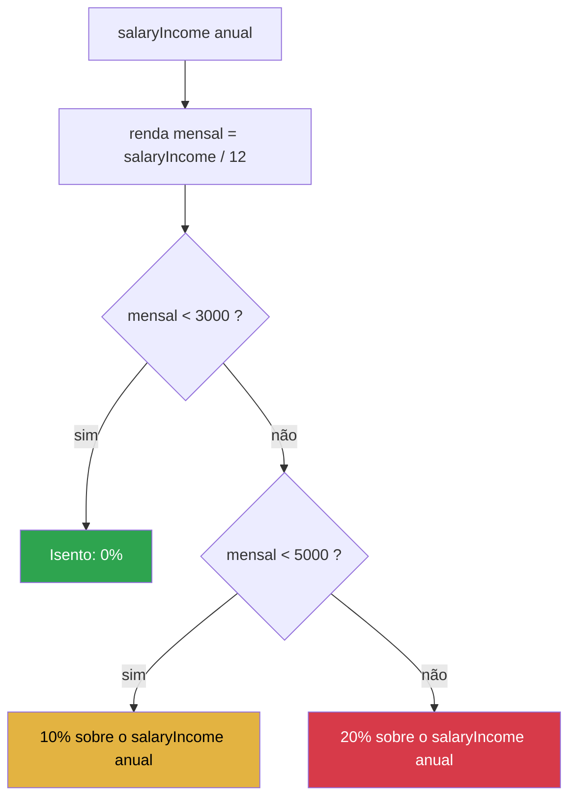
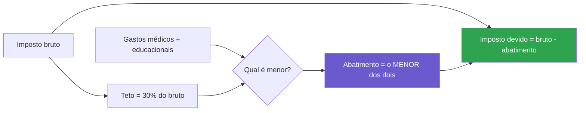
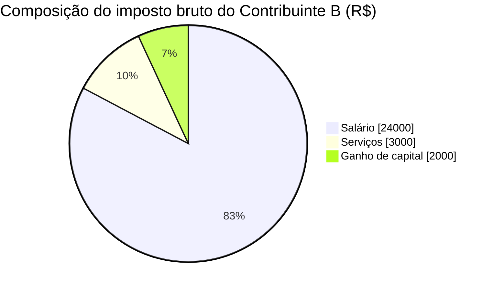
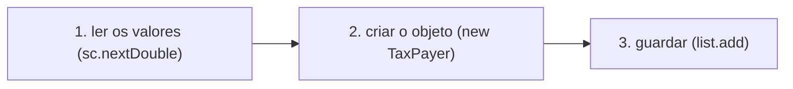

<div align="center">

# 💰 Contribuintes OO e Lista

### Cálculo de imposto de renda com **Programação Orientada a Objetos** em Java


*Desafio do capítulo **Memória, vetores e listas** — curso **Java e Programação Orientada a Objetos Expert** (Nélio Alves / DevSuperior)*

</div>

---

## 📑 Índice

- [🎯 Visão geral](#-visão-geral)
- [🧭 Como o programa funciona](#-como-o-programa-funciona)
- [🧱 Modelagem das classes](#-modelagem-das-classes)
- [🧮 Regras de negócio](#-regras-de-negócio)
- [🧪 Exemplos com passo a passo](#-exemplos-com-passo-a-passo)
- [🧠 Conceitos aplicados](#-conceitos-aplicados)
- [⚠️ Armadilhas que encontrei](#️-armadilhas-que-encontrei)
- [📂 Estrutura do projeto](#-estrutura-do-projeto)
- [▶️ Como executar](#️-como-executar)
- [🚀 Próximas melhorias](#-próximas-melhorias)
- [💼 Habilidades demonstradas](#-habilidades-demonstradas)

---

## 🎯 Visão geral

Este projeto resolve um problema do mundo real: **calcular o imposto devido por vários contribuintes**, cada um com rendas e gastos diferentes.

O programa:

1. 📥 **Lê** os dados de N contribuintes pelo teclado.
2. 🏗️ **Cria um objeto** `TaxPayer` para cada um, com tudo organizado dentro de uma classe.
3. 🗂️ **Guarda** todos em uma lista (`List<TaxPayer>`).
4. 🧾 **Percorre a lista** e imprime o resumo de cada contribuinte: imposto bruto, abatimento e imposto devido.

> 💡 **Por que este desafio importa?** Ele junta, em um único exercício, os pilares que um desenvolvedor usa todos os dias: **modelar dados com classes, encapsular regras de negócio, trabalhar com coleções e formatar saídas**.

### 📊 Em números

| Item | Quantidade |
|---|---|
| Classes principais | 2 (`TaxPayer` e `Program`) |
| Atributos por contribuinte | 5 |
| Métodos de cálculo | 6 (`salaryTax`, `servicesTax`, `capitalTax`, `grossTax`, `taxRebate`, `netTax`) |
| Estrutura de dados | `ArrayList<TaxPayer>` |

---

## 🧭 Como o programa funciona

### Fluxo geral



### Quem conversa com quem



---

## 🧱 Modelagem das classes



**Como ler o diagrama:**

- `-` significa **privado**: ninguém de fora mexe direto no atributo (**encapsulamento**).
- `+` significa **público**: qualquer classe pode chamar o método.
- `Program` **cria** os `TaxPayer` e **guarda** todos em uma lista.

### Quem depende de quem dentro do `TaxPayer`



> 🧩 Cada método faz **uma coisa só** e reaproveita os outros. Se a regra do imposto sobre serviços mudar, eu altero **um único lugar**.

---

## 🧮 Regras de negócio

### 💼 Imposto sobre salário (com faixas)

> ⚠️ A tabela de faixas é **mensal**, mas o dado é **anual**. Por isso comparo `salaryIncome / 12` com as faixas, mas aplico a porcentagem sobre o valor **anual**.



| Renda mensal | Alíquota |
|---|---|
| Menos de R$ 3.000,00 | 0% (isento) |
| De R$ 3.000,00 até R$ 5.000,00 (exclusive) | 10% |
| R$ 5.000,00 ou mais | 20% |

### 🛠️ Outras rendas

| Tipo de renda | Alíquota |
|---|---|
| Prestação de serviços | 15% |
| Ganho de capital | 20% |

### 🎁 Abatimento

O contribuinte pode abater gastos médicos e educacionais, **mas só até 30% do imposto bruto**.



Esse é o padrão **"no máximo X"**: o valor final é o **menor** entre o que a pessoa gastou e o teto permitido (`Math.min`).

---

## 🧪 Exemplos com passo a passo

> 📌 Exemplos **ilustrativos**, calculados com as regras acima, para mostrar o raciocínio do programa.

### Visão comparada

| | Salário anual | Serviços | Capital | Gastos (saúde + educação) | **Bruto** | **Abatimento** | **Devido** |
|---|---:|---:|---:|---:|---:|---:|---:|
| **A** | 50.000,00 | 0,00 | 0,00 | 3.000,00 | 5.000,00 | 1.500,00 | **3.500,00** |
| **B** | 120.000,00 | 20.000,00 | 10.000,00 | 8.000,00 | 29.000,00 | 8.000,00 | **21.000,00** |
| **C** | 24.000,00 | 0,00 | 5.000,00 | 500,00 | 1.000,00 | 300,00 | **700,00** |

```text
Contribuinte B — para onde vai o imposto bruto de R$ 29.000,00

Salário    ████████████████████████████████████████░░░░░░░░░░░░░░░░  82,8%
Serviços   █████░░░░░░░░░░░░░░░░░░░░░░░░░░░░░░░░░░░░░░░░░░░░░░░░░░░  10,3%
Capital    ███░░░░░░░░░░░░░░░░░░░░░░░░░░░░░░░░░░░░░░░░░░░░░░░░░░░░░   6,9%
```



<details>
<summary><b>🔍 Clique para ver o cálculo completo do Contribuinte B</b></summary>

<br>

**Dados:** salário 120.000,00 · serviços 20.000,00 · capital 10.000,00 · saúde 5.000,00 · educação 3.000,00

| Etapa | Conta | Resultado |
|---|---|---:|
| 1. Renda mensal do salário | 120.000 ÷ 12 | 10.000,00 (acima de 5.000 → **20%**) |
| 2. Imposto do salário | 120.000 × 0,20 | 24.000,00 |
| 3. Imposto de serviços | 20.000 × 0,15 | 3.000,00 |
| 4. Imposto de capital | 10.000 × 0,20 | 2.000,00 |
| 5. **Imposto bruto** | 24.000 + 3.000 + 2.000 | **29.000,00** |
| 6. Teto de abatimento | 29.000 × 0,30 | 8.700,00 |
| 7. Gastos | 5.000 + 3.000 | 8.000,00 |
| 8. **Abatimento** | menor entre 8.700 e 8.000 | **8.000,00** |
| 9. **Imposto devido** | 29.000 − 8.000 | **21.000,00** |

</details>

<details>
<summary><b>🔍 Clique para ver o cálculo do Contribuinte A (faixa de 10%)</b></summary>

<br>

| Etapa | Conta | Resultado |
|---|---|---:|
| Renda mensal | 50.000 ÷ 12 | 4.166,67 (entre 3.000 e 5.000 → **10%**) |
| Imposto do salário | 50.000 × 0,10 | 5.000,00 |
| Imposto bruto | 5.000 + 0 + 0 | 5.000,00 |
| Teto de abatimento | 5.000 × 0,30 | 1.500,00 |
| Gastos | 2.000 + 1.000 | 3.000,00 |
| **Abatimento** | menor entre 1.500 e 3.000 | **1.500,00** (o teto limitou) |
| **Imposto devido** | 5.000 − 1.500 | **3.500,00** |

> 💡 Aqui o **teto de 30%** entrou em ação: a pessoa gastou R$ 3.000,00, mas só pôde abater R$ 1.500,00.

</details>

<details>
<summary><b>🔍 Clique para ver o cálculo do Contribuinte C (salário isento)</b></summary>

<br>

| Etapa | Conta | Resultado |
|---|---|---:|
| Renda mensal | 24.000 ÷ 12 | 2.000,00 (abaixo de 3.000 → **isento**) |
| Imposto do salário | — | 0,00 |
| Imposto de capital | 5.000 × 0,20 | 1.000,00 |
| Imposto bruto | 0 + 0 + 1.000 | 1.000,00 |
| Teto de abatimento | 1.000 × 0,30 | 300,00 |
| Gastos | 400 + 100 | 500,00 |
| **Abatimento** | menor entre 300 e 500 | **300,00** |
| **Imposto devido** | 1.000 − 300 | **700,00** |

</details>

---

## 🧠 Conceitos aplicados

Clique em cada tópico para ver a explicação, o código e o raciocínio.

<details>
<summary><b>🔒 1. Encapsulamento</b></summary>

<br>

Todos os atributos são `private`, com `get` e `set` públicos. Assim, a classe **controla** como seus dados são lidos e alterados.

```java
private double salaryIncome;

public double getSalaryIncome() {
    return salaryIncome;
}

public void setSalaryIncome(double salaryIncome) {
    this.salaryIncome = salaryIncome;
}
```

**Regra prática que usei:** *"esse valor pode mudar depois que o objeto foi criado?"*

| Resposta | O que criar |
|---|---|
| Sim | `get` + `set` |
| Não | só `get` |

O desafio pedia `get` e `set` nos 5 atributos.

</details>

<details>
<summary><b>📐 2. Seguir o enunciado ao pé da letra</b></summary>

<br>

Os nomes e tipos seguem o diagrama do desafio (`salaryIncome`, e não `salary`; `double` primitivo, e não `Double`).

Em projetos reais, **nomes e contratos combinados não se mudam por gosto**: outras pessoas e sistemas dependem deles. No desafio, o avaliador confere isso.

</details>

<details>
<summary><b>🔢 3. double vs Double</b></summary>

<br>

| | `double` | `Double` |
|---|---|---|
| Tipo | primitivo | wrapper (objeto) |
| Pode ser `null`? | ❌ não | ✅ sim |
| Quando usar | o valor **sempre existe** | "sem valor" é uma situação real, ou dentro de coleções (`List<Double>`) |

Aqui escolhi `double`, porque quando não há renda o valor é `0.00`, nunca "vazio".

```java
Double renda = null;
double conta = renda * 2;   // 💥 NullPointerException
```

</details>

<details>
<summary><b>🧩 4. Métodos de cálculo não são atributos</b></summary>

<br>

`grossTax()`, `taxRebate()` e `netTax()` **não têm `get`/`set`**, porque não são dados guardados: são **cálculos**.

Eles também **chamam outros métodos da classe** em vez de refazer a conta:

```java
public double grossTax() {
    return salaryTax() + servicesTax() + capitalTax();
}

public double netTax() {
    return grossTax() - taxRebate();
}
```

Benefício: cada regra existe em **um só lugar** (princípio **DRY**: *Don't Repeat Yourself*).

</details>

<details>
<summary><b>📏 5. Faixas com if / else if / else</b></summary>

<br>

A faixa "de 3.000 até 5.000 **exclusive**" fica simples quando se testa de baixo para cima:

```java
public double salaryTax() {
    double monthly = salaryIncome / 12.0;

    if (monthly < 3000.0) {
        return 0.0;
    } else if (monthly < 5000.0) {
        return salaryIncome * 0.10;
    } else {
        return salaryIncome * 0.20;
    }
}
```

Cada `else if` só é testado se o anterior falhou, então não preciso escrever "maior ou igual a 3000" de novo.

</details>

<details>
<summary><b>🎁 6. Padrão "no máximo X" com Math.min</b></summary>

<br>

```java
public double taxRebate() {
    double max = grossTax() * 0.30;
    double spending = healthSpending + educationSpending;
    return Math.min(max, spending);
}
```

O método só **descobre** o valor do desconto. A subtração fica no `netTax()`. Assim, cada método tem **uma responsabilidade**.

</details>

<details>
<summary><b>🗂️ 7. Lista de objetos (ArrayList)</b></summary>

<br>

```java
List<TaxPayer> list = new ArrayList<>();
```

- O tipo entre `< >` é o que a lista **aceita guardar**. Uma `List<Double>` não aceitaria um `TaxPayer`.
- `List` é a **interface** (o contrato) e `ArrayList` é a **implementação**.

**Ordem dentro do `for` de leitura:**



> `sc.nextDouble()` **lê** do teclado. `list.add(obj)` só **guarda** um objeto que já existe.

</details>

<details>
<summary><b>👉 8. A regra do ponto: quem.oQueFazer()</b></summary>

<br>

| Antes do ponto | Significa | Exemplo |
|---|---|---|
| uma **variável** | o objeto que sabe fazer a ação | `sc.nextDouble()`, `list.add(pay)`, `pay.netTax()` |
| **Letra maiúscula** | uma classe (método `static`) | `Math.min(a, b)` |
| nada (dentro da classe) | o próprio objeto, o `this` implícito | `salaryTax()` |

</details>

<details>
<summary><b>🔁 9. for each e os dois "get" diferentes</b></summary>

<br>

```java
int count = 1;
for (TaxPayer pay : list) {
    System.out.println();
    System.out.println("Resumo do " + count + "o contribuinte:");
    System.out.printf("Imposto bruto total: %.2f%n", pay.grossTax());
    System.out.printf("Abatimento: %.2f%n", pay.taxRebate());
    System.out.printf("Imposto devido: %.2f%n", pay.netTax());
    count++;
}
```

**Dois `get` com significados diferentes:**

| Chamada | O que faz |
|---|---|
| `list.get(i)` | pega um **item da lista** pela posição |
| `obj.getAtributo()` | lê um **atributo** de dentro do objeto |

No `for each`, o objeto da vez já vem na variável `pay`, então não preciso de `list.get`.

**Detalhe do contador:** ele é criado **fora** do loop e incrementado no **fim** de cada volta. Se ficasse dentro, voltaria a valer 1 em toda volta.

</details>

<details>
<summary><b>🖨️ 10. Saída formatada</b></summary>

<br>

| Recurso | Para que serve |
|---|---|
| `Locale.setDefault(Locale.US);` | usar **ponto** decimal (`3500.00`) em vez de vírgula |
| `printf("%.2f%n", valor)` | mostrar **2 casas decimais** e quebrar a linha |
| `System.out.print(...)` (sem `ln`) | o valor digitado fica **na mesma linha** da pergunta |
| `System.out.println();` | linha em branco, como no exemplo do enunciado |

</details>

---

## ⚠️ Armadilhas que encontrei

Registrar os erros também faz parte da jornada.

<details>
<summary><b>Ver as 5 armadilhas e como resolvi</b></summary>

<br>

| # | Armadilha | Como resolvi |
|---|---|---|
| 1 | Comparar o salário **anual** com a tabela **mensal** | Dividir por 12 só na comparação, aplicando a % sobre o valor anual |
| 2 | Usar `Double` e tomar `NullPointerException` | Usar `double` primitivo, porque o valor sempre existe |
| 3 | Contador do `for each` voltando para 1 | Criar o contador **fora** do loop |
| 4 | Confundir `list.get(i)` com `obj.getAtributo()` | Entender que o primeiro lê da **lista** e o segundo, do **objeto** |
| 5 | Mudar nomes de atributos do diagrama | Seguir exatamente o enunciado |

</details>

---

## 📂 Estrutura do projeto

<!-- Ajuste a árvore abaixo para ficar igual à estrutura real da pasta -->

```text
Contribuinte/
├── src/
│   ├── application/
│   │   └── Program.java     → leitura dos dados, lista e impressão do resumo
│   └── entities/
│       └── TaxPayer.java    → atributos, encapsulamento e cálculos de imposto
└── README.md
```

---

## ▶️ Como executar

```bash
# 1. Clone o repositório
git clone https://github.com/yuritavaresx/curso-java-orientacao-objeto.git

# 2. Entre na pasta do desafio
cd curso-java-orientacao-objeto/capitulo-08/Contribuinte
```

3. Abra a pasta no **IntelliJ IDEA**.
4. Confirme que a pasta `src` está marcada como **Sources Root** (botão direito em `src` → *Mark Directory as* → *Sources Root*).
5. Execute a classe `Program`.

**Requisito:** JDK instalado (Java 11 ou superior).

---

## ✅ Como testei

| Teste | Resultado |
|---|---|
| Os 2 contribuintes do exemplo do enunciado | Saída idêntica à esperada |
| Contribuinte com salário isento (mensal abaixo de 3.000) | Imposto de salário igual a 0 |
| Gastos acima do teto de 30% | Abatimento limitado ao teto |
| Gastos abaixo do teto de 30% | Abatimento igual aos gastos |

---

## 🚀 Próximas melhorias

- [ ] Usar `BigDecimal` no lugar de `double` para valores em dinheiro (evita erros de arredondamento).
- [ ] Validar as entradas (valores negativos não fazem sentido).
- [ ] Criar testes automatizados com **JUnit** para cada regra de imposto.
- [ ] Trocar os números fixos (`0.10`, `0.15`, `0.20`) por **constantes** com nome.

---

## 💼 Habilidades demonstradas


| Habilidade | Onde aparece neste projeto |
|---|---|
| Modelagem orientada a objetos | Classe `TaxPayer` com atributos e comportamentos |
| Encapsulamento | Atributos privados com `get` e `set` |
| Regras de negócio | Faixas de imposto, teto de abatimento |
| Coleções | `List<TaxPayer>` com `ArrayList` |
| Reaproveitamento de código | Métodos que chamam outros métodos (DRY) |
| Clareza e documentação | Este README, com diagramas e exemplos |
| Versionamento | Histórico organizado por capítulo no GitHub |

---

<div align="center">

### 👨‍💻 Feito por **Yuri Tavares**

Estudante de Análise e Desenvolvimento de Sistemas (FATEC), em busca da primeira oportunidade em desenvolvimento de software.

[](https://github.com/yuritavaresx)
[](https://github.com/yuritavaresx/curso-java-orientacao-objeto)

⭐ *Este projeto faz parte da minha jornada de estudos em Java e Orientação a Objetos.*

</div>
